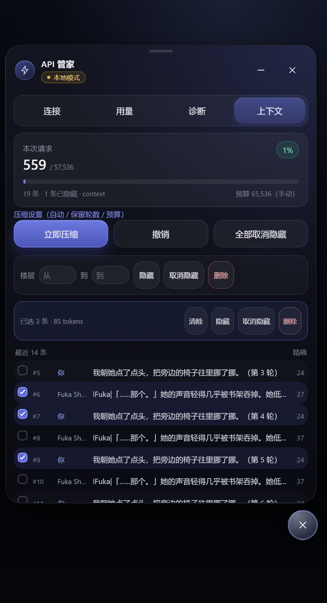

# API 悬浮管家

TauriTavern / SillyTavern 的常驻悬浮面板：多 API 一键切换、用量统计、上下文压缩。

> 当前版本：**0.7.5** · 适用于 TauriTavern 2.3.0（SillyTavern 1.18 前端）
> 支持 Windows 客户端、Android 客户端，以及普通 SillyTavern 网页版（本地模式）。



## 功能

- **多 API 管理**：Base URL / Key / 模型 / 提供商；一键切换，测试通过后自动恢复酒馆连接状态（插头变绿）。
- **用量统计**：本机请求数、输入/输出 tokens，按天归档。
- **诊断**：宿主 ABI、酒馆设置、DOM、端点格式探测，一键复制。
- **上下文管家**：
  - 实时显示本次请求的 token 占用量与预算占比；
  - 逐条消息 tokens，支持勾选或「从 # 到 #」楼层区间；
  - 隐藏 / 取消隐藏 / 删除（可恢复）；
  - 摘要压缩或只隐藏；自动压缩支持「每 N 轮」与比例阈值；
  - 角色卡、预设、世界书全程只读。

## 目录结构

```
.
├─ API悬浮管家.script.json      # 手机端：酒馆助手导入
├─ 使用说明.md                  # 完整安装 / 使用 / 排错
├─ README.md
├─ LICENSE .md
├─ 感谢兄弟们.png               # 支持作者
├─ pc/                          # 电脑端扩展
│  ├─ index.js
│  ├─ style.css
│  ├─ manifest.json
│  └─ install.ps1
├─ mobile/                      # 手机端源码与构建脚本
│  ├─ mobile.js
│  ├─ build-mobile.ps1
│  ├─ build-script-json.ps1
│  ├─ README.md
│  └─ dist/tauri-api-manager-mobile/
└─ screenshots/
```

## 快速开始

### 电脑版

```powershell
cd pc
pwsh -File .\install.ps1
```

默认安装到：

```
%APPDATA%\com.tauritavern.client\data\extensions\third-party\tauri-api-manager
```

装完重启 TauriTavern 或刷新页面，右下角出现圆形悬浮球。

### 手机版（推荐）

酒馆助手 → 脚本库 → 全局 → 导入 → 选择 `API悬浮管家.script.json` → 打开脚本开关。

### 普通 SillyTavern

把 `pc/` 里的 `index.js`、`style.css`、`manifest.json` 放进
`data/<user>/extensions/tauri-api-manager/`，刷新页面。

## 上下文预算怎么选

实测（羽毛笔 + 猎人游戏，前缀 5,505）：

| 单条回复 | 最低档 | 舒适档 |
|---|---:|---:|
| 500 字 | 3 万 | 5 万 |
| 1000 字 | 5 万 | 9 万 |
| 2000 字 | 5 万（21 轮） | 9 万（41 轮） |
| 5000 字 | 11 万 | 17 万（需模型支持） |
| 1 万字 | 13 万 | 17 万（需模型支持） |

- 预设把上下文写成 `2,000,000` 时，自动压缩几乎不会触发；先在「上下文 → 压缩设置 → 有效预算」里选一个真实档位。
- 长聊天建议「每 10 轮」自动压一次，保留最近 6 轮；2000 字以上回复建议保留 4 轮。
- 超过模型真实上下文的档位（如 DeepSeek 128k 选 30 万）只会在请求时被模型截断，不要选。

## 构建

```powershell
cd mobile
pwsh -File .\build-mobile.ps1      # 扩展目录
pwsh -File .\build-script-json.ps1 # 酒馆助手 JSON（输出到仓库根目录）
```

## 支持作者

如果这个插件帮到你，可以请作者喝瓶水：


## 许可

见 [LICENSE .md](LICENSE%20.md)。

## 更新记录

- **0.7.5**：超长消息截断保护、预算装不下保留轮数时警告、设置内附档位参考。
- **0.7.4**：有效预算档位改为 1 万–20 万。
- **0.7.3**：长聊天摘要分批（单次 4 万字符）。
- **0.7.2**：并发压缩串行化、越界楼层裁剪、首楼保护、生成中禁止改动。
- **0.7.1**：修复上下文 tab 抖动与「没有聊天记录」误报、楼层区间、按轮数自动压缩。
- **0.7.0**：新增上下文管家。

完整说明见 [使用说明.md](使用说明.md)。
