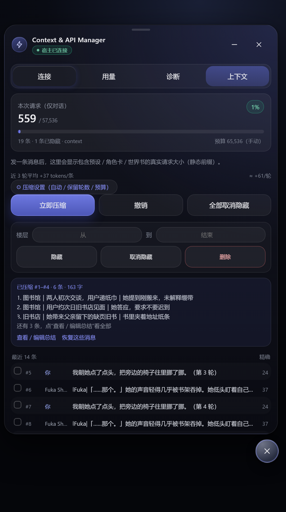
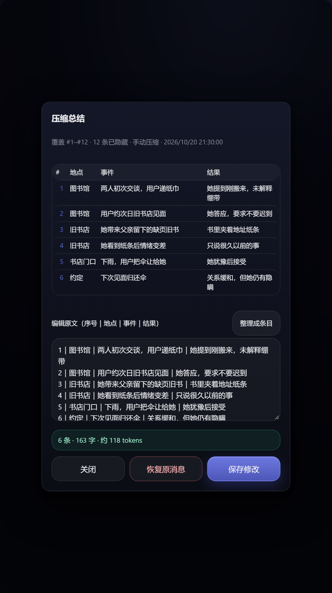

-这个预设是我根据改动夏瑾_天琴座_V2_Beta_1.0改的，因为我要使用手机的llocal dream生图里面应该会有每轮对话都生成提示词，如果用不到的话请删掉!!

#Context & API Manager

TauriTavern / SillyTavern 的常驻悬浮面板：多 API 一键切换、用量统计、上下文压缩。

> 当前版本：**0.8.2** · 适用于 TauriTavern 2.3.0（SillyTavern 1.18 前端）
> Windows 客户端 / Android 客户端 / 普通 SillyTavern 网页版（本地模式）
>
> 手机端发布包：`Context & API Manager.json`（酒馆助手脚本列表同名）



---

## 一、这个项目做了什么

把「API 档案管理」和「上下文预算管理」从酒馆设置面板搬进一个常驻悬浮窗，并且**不改角色卡、不改预设、不改世界书**。

四个 tab：

| tab | 能力 |
|---|---|
| 连接 | 新增 / 切换 / 编辑 / 删除 API，导入导出，故障切换 |
| 用量 | 本机请求数、输入 / 输出 tokens，按天归档 |
| 诊断 | 宿主 ABI、酒馆设置、DOM、端点格式探测 |
| 上下文 | token 占用、真实请求大小、压缩总结、查看/编辑总结、隐藏 / 删除、自动压缩 |

---

## 二、目录结构

```
api-floating-manager/
├─ Context & API Manager.json  手机端：酒馆助手导入
├─ README.md                   本文件（开发总结）
├─ 使用说明.md                 用户手册
├─ LICENSE .md
├─ 轻舟·通用预设.json         配套预设（可选）
├─ pc/                         电脑端扩展源码
│  ├─ index.js  style.css  manifest.json
│  ├─ install.ps1
│  └─ tests/                   13 套回归测试（可直接 node 跑）
├─ mobile/                     手机端补丁与构建
│  ├─ mobile.js
│  ├─ build-mobile.ps1
│  ├─ build-script-json.ps1
│  ├─ README.md
│  └─ dist/tauri-api-manager-mobile/
└─ screenshots/
```

`pc/` 是唯一源码目录；`mobile/` 只维护 `mobile.js` 补丁和两个构建脚本，构建时复用 `pc/`；`pc/tests/` 直接对 `pc/index.js` 做回归。

---

## 三、架构与关键技术点

### 3.1 宿主访问层

所有 TauriTavern ABI 调用集中在 `host` 对象里：

- `host.api()` / `host.llmConnections()` / `host.tt()`
- 有 ABI 时走宿主连接管理；没有时退化为本地直连（普通酒馆）
- `waitReady()` + `watchHostLate()` 处理 ABI 晚注入，避免悬浮球永远不出现

### 3.2 连接切换

1. 写入并激活新 Key（`/api/secrets/write` + `/rotate`）
2. 调用 `readSecretState()` 刷新酒馆内存里的 secret 缓存
3. 在 `withConnectionValidationSuspended()` 作用域内写 URL / 来源 / 模型
4. 扩展自己测试一次
5. 测试成功才触发一次酒馆状态检查 → 插头变绿、发送按钮恢复

切换期间用 capture 监听拦掉酒馆自动触发的「连接」点击，避免红色报错。

### 3.3 Key 存储

- 宿主 `extension_settings` 里永远脱敏（`key: ''`）。
- `localStorage` 镜像**有宿主时默认不写明文**，只保留 `secretRef`；纯网页没有密钥库时才默认保留本地镜像（否则刷新后 Key 必丢），UI 会明示。
- 旧版本升级会迁移一次：
  - 有 TauriTavern 宿主：关闭本地镜像，宿主机密库作为唯一真源；
  - 纯网页版没有密钥库：保留一次本地镜像，避免升级后 Key 丢失，并在「诊断 → 最近错误」记录一条。
- 导入带 Key 的配置会先写进宿主 secrets，再存 `secretRef`。
- 需要离线兜底时，在「用量」页打开「本地镜像保存 Key」。
- 导出「含 Key」时从 secrets 按 `secretRef` 补回。
- 诊断 JSON 会脱敏：URL 只保留 origin，Key / `sk-*` 一律 `****`。
- 诊断页的「最近错误」环形队列保存最近 20 条，不记录请求体和 Key。

### 3.4 上下文管家

**计数**

- 整段请求：`/api/tokenizers/openai/count`
- 逐条：`/count-batch`
- 不可用时退化为 `ctxEstimate`（中文 ~0.72 token/字，英文 ~3.8 字符/token）
- **真实请求大小**：从 fetch hook 截获每次对话的请求体，响应里的 `usage.prompt_tokens` 减去当前聊天，反推出「静态前缀」（预设 + 角色卡 + 世界书 + 总结）。聊天切换、超过 6 小时或聊天长度回退时作废。同时记录输出是否吃满 `max_tokens`，在面板提示可能被截断。

**预算**

```
可用 = min(酒馆上下文, 有效预算) - min(回复预留, 35%, 16384)
```

预设写 `2,000,000` 时自动压缩不会触发，面板会提示设「有效预算」。
回复预留封顶 16k，避免预设把 `max_tokens` 写成 65535 时可用预算被吃掉一半。
自动压缩比较的是「聊天 + 实测静态前缀」，不再只数聊天；否则重预设永远到不了阈值。
建议档位按 `前缀 + 24 轮 ×（回复 + 用户发言）` 反推，不再把回复乘 2。

**压缩**

1. 取「保留最近 N 轮」之前的消息，单次最多 4 万字符
2. 单条消息最多 8,000 字符，超出标记截断
3. 条目式（默认）调用当前连接生成 `序号｜地点｜事件｜结果`，每条 ≤ 35 字、最多 8 条；也可在设置里切回段落式
4. 请求带 `thinking: {type: 'disabled'}`（DeepSeek / 思考模型），避免 800 tokens 全被思考吃掉
5. 正文为空且 `finish_reason=length` / 有 `reasoning_content` 时，自动加大预算重试；代理不认 `thinking` 字段（400）时自动退回
6. 全部重试仍为空：手动压缩改用「本地摘要」兜底（预览里会标注，可编辑）
7. 先隐藏旧消息，再注入 extension prompt；注入失败自动回滚隐藏
8. 总结写入 `chatMetadata`，重进聊天自动恢复
9. 再次压缩时把「旧总结 + 新对话」合并：保留有效设定 / 关系 / 未兑现约定，删重复和已解决项，重新编号
10. 总结注入用 `【前情提要】\n` + 条目原文；表格只在 UI 渲染，不把 Markdown 表格写进 prompt
11. **图片楼层有两种策略**：`keep`（默认）整楼跳过，图片绝不会被吞；`trim` 保留图片标签、压掉正文（总结覆盖正文，撤销可恢复原文），适合每轮都带 `<local_img>` 的聊天；手动「隐藏」始终跳过图片楼层

**条目式为什么更省**

同一段 2 轮对话、同一个 `deepseek-flash`：

| 形式 | 输出 tokens | 说明 |
|---|---:|---|
| 段落式 | 116 | 170 字叙述 |
| 条目式 | 71 | 3 条 `序号｜地点｜事件｜结果` |
| Markdown 表格 | 161 | 表头 + `|` 分隔线，反而更贵（另一组样本） |

条目式比段落式少约 **39%**（另一组样本 80 vs 147，少 46%，会随对话长度波动）。条目会每轮注入，24 轮大约再省 1.1k 输入 tokens；总结请求本身的提示词会多约 130 tokens，按 3 轮左右回本。关键是**别存 Markdown 表格**：管道条目已经够结构化，表格交给界面渲染。

**查看 / 编辑总结**

压缩后列表上方显示「已压缩 #a–#b · N 条」，可打开总结界面：

- 表格视图：`# / 地点 / 事件 / 结果`，一条一行
- 原文编辑：`序号｜地点｜事件｜结果`，改完表格实时同步
- 「整理成条目」把旧版段落拆成条目
- 保存后重新注入 `extension prompt`
- 一键恢复这些消息（取消隐藏 + 删除总结）
- 切换聊天时自动关闭，避免把总结写到别的聊天



**预览与确认**

- 手动压缩先弹预览：可编辑总结、看预计 token 变化、取消 / 重新生成 / 应用
- 生成总结最多等 60 秒（思考模型会慢一些）
- 「发送前确认」默认开启：确认前不会把消息发给 API
- 自动压缩不确认（否则无法自动），面板明示发送目标

**隐藏 / 删除**

- 隐藏 = `is_system = true`，不进 prompt，但酒馆楼层保留（这是酒馆 `/hide` 语义）
- 删除 = 真正移除楼层并重排，删前存快照，可恢复
- 两类操作后都会 `printMessages()` 刷新酒馆 UI

### 自动压缩

- 触发条件：`每 N 轮` 或 `（聊天 + 实测前缀）≥ 阈值`
- 生成结束后触发，15 秒内不重复
- 生成中禁止手动改动

---

## 四、测试矩阵

13 套测试（`pc/tests/`，直接 `node pc/tests/xxx.test.mjs`）：

| 套件 | 覆盖 |
|---|---|
| context | 估算、总结模板、压缩范围、预算、精确计数退化 |
| context-summary | 思考模型 `thinking.disabled`、空正文重试、content 数组、400 退回、本地兜底、查看/编辑总结、实测前缀、事件触发、错误队列、条目式表格、secrets/find、完整 endpoint |
| context-abnormal | 越界楼层、空输入、首楼保护、连点压缩、单条聊天、异常设置、并发渲染、XSS、全部取消隐藏、预览取消 |
| context-brutal | 10k 消息、5k 区间、1MB 文本、1000 点击、200 渲染、2000 组 fuzz |
| context-superbrutal | 100k 消息、50k 区间、1MB 估算、5000 条恶意文本、100 并发压缩、故障注入、500 条导入并发、UI 混乱、配额异常 |
| context-risks | 明文 Key、总结发送时机、发送前确认、secretRef、用量 hook、重新生成、前缀精度 |
| diagnostics | URL 脱敏、storeKeys 迁移、纯网页保留旧 Key、开发者模式、临时连接清理、错误区块 |
| preview-abort | 预览取消真正 abort、关闭界面、损坏 meta 撤销不抛异常 |
| image-safe | `<local_img>` / `<loacl_img>` / HTML / Markdown 图片楼层不压缩、保持可见、总结请求不含图片提示词 |
| summary-rows-brutal | 5000 行封顶、HTML/script 渲染、重复弹层、50k 字拒绝保存、事件风暴 |
| multi-api | 连接 / 切换 / 密钥 / 导入导出 / 悬浮球 / 故障转移 |
| usage | JSON/SSE usage 提取、错误不计数、31 天裁剪、清空 |
| stress | 批量、恶意导入、存储异常、宿主异常、并发切换 |

实测性能：

```
100k 消息规划     25 ms
50k 区间合并      17 ms
1MB 文本估算      30 ms
1000 次点击       ~220 ms
200 次渲染        ~1.0 s
```

真实 API 补充实测（3 卡 × 4 轮，`keepTurns=2`，第 3 轮后压缩）：

| 预设 | completion | reasoning | 正文字符 | 空正文 | 压缩总结 |
|---|---:|---:|---:|---:|---|
| 夏瑾原版 | 44,784 | 39,101 | 8,733 | 8 / 12 | 4 / 1 / 1 条 |
| 无思考严格版 | 8,934 | 0 | 13,444 | 0 / 12 | 3 / 4 / 3 条 |

原版把思考写进正文、长卡空正文；严格版更快、更稳。完整数据在
`preset-lab/out/preset-compare-compress.md`（开发环境）。插件压缩本身三组都成功隐藏 2 条并注入总结。

---

## 五、已知限制与取舍

1. **隐藏不会移除楼层**：酒馆 `/hide` 本来就是这样；要移除请用删除。
2. **自动压缩在生成之后**：某一轮仍可能先冲高，酒馆自身会截断兜底。
3. **静态前缀压不掉**：前缀超过预算时压缩历史没有意义，面板会直接提示。
4. **Key 默认不落本地**：酒馆 secrets 被清空后需要重新填 Key。
5. **总结会发往当前激活 API**：已用「发送前确认」和面板提示明示。
6. **纯网页酒馆没有 secrets**：默认仍不写明文；只有从旧版本升级且本地已有 Key 时才保留一次镜像，避免丢 Key。
7. **思考模型会吃输出预算**：DeepSeek 混合思考模型单轮可能花 1–4k 思考 tokens；插件请求总结时已关闭思考，聊天生成仍需在模型侧留够输出。
8. **本地兜底摘要质量有限**：只在模型连续返回空正文时使用，界面会标注「本地摘要·未经模型」，建议检查后再应用。

---

## 六、版本历史

- **0.8.2**：图片消息保护 + 可选压图模式（保留标签、压正文、撤销恢复）；总结硬上限 220 字防止滚雪球；密钥读取改走 `/api/secrets/find`（read 返回掩码时不再 401）；完整 endpoint 自动去 `/chat/completions`；自动压缩新增“每 2 轮”；CSS 变量/圆角/手机端高度修正；预览取消真正中止请求；`secrets.write` 记录 HTTP 状态；补充 13 套测试
- **0.8.1**：宿主默认不写明文 Key + 旧数据迁移；最近错误环形队列；诊断脱敏 / 开发者模式 / 一键清理临时连接；自动压缩改为 `tam:request-measured` 事件驱动 + 消息指纹校验；总结改为条目式（表格查看，同段对话比段落式少约 39–46% output tokens）；全面更名 `Context & API Manager`
- **0.8.0**：总结请求兼容思考模型（thinking.disabled / 空正文重试 / 400 退回 / 本地兜底）；查看/编辑总结界面；楼层区间工具条排版；真实请求大小采集与静态前缀；自动压缩与档位建议计入前缀；档位公式修正
- **0.7.13**：10 项 P0/健壮性修复（secretRef、原始 fetch、注入回滚、UI 刷新、并发导入等）
- **0.7.12**：默认不写明文 Key；导入先落 secrets；发送前确认
- **0.7.11**：建议档位精确计数；发送前确认开关
- **0.7.10**：修复展开压缩设置空白
- **0.7.9**：压缩预览、动态预算建议
- **0.7.8**：增量摘要合并、切聊天保护、每轮增长显示
- **0.7.7**：重前缀警告、100/200 万档位
- **0.7.6**：提示换行、最小化空白、误报修正
- **0.7.5**：超长消息截断、保留轮数容量警告
- **0.7.4**：预算档位 1 万–20 万
- **0.7.3**：长聊天摘要分批
- **0.7.2**：并发压缩串行化、首楼保护
- **0.7.1**：修复抖动与「没有聊天记录」误报、楼层区间、按轮数自动压缩
- **0.7.0**：上下文管家

---

## 七、构建与发布

```powershell
# 电脑端
cd pc
pwsh -File .\install.ps1

# 手机端扩展目录 + 酒馆助手 JSON
cd ..\mobile
pwsh -File .\build-mobile.ps1
pwsh -File .\build-script-json.ps1
```

`build-script-json.ps1` 会把 JSON 输出到仓库根目录 `Context & API Manager.json`，脚本 id 固定为 `tauri-api-manager`，重复导入会覆盖旧样式与脚本。

测试（`pc/tests/`）：

```powershell
cd pc
node tests\context.test.mjs
node tests\image-safe.test.mjs
node tests\preview-abort.test.mjs
```

`pc/tests` 依赖开发环境的 happy-dom；它是源码回归，不参与扩展运行时。

### 手机端没有 JSON / 找不到文件

这个 JSON **不是运行时自动生成的**，必须跑一次构建脚本。构建成功后：

```powershell
cd D:\TauriTavern\js\api-floating-manager\mobile
pwsh -File .\build-script-json.ps1
Get-Item '..\Context & API Manager.json'
```

正常会看到类似：

```
Length  LastWriteTime
219xxx  2026/10/20 21:xx:xx
```

如果 `Get-Item` 报「找不到路径」，说明脚本没有真正执行完（看它上面的第一行报错），或者你改了 `-OutFile`。也可以显式指定输出：

```powershell
pwsh -File .\build-script-json.ps1 -OutFile "D:\TauriTavern\js\api-floating-manager\Context & API Manager.json"
```

导入手机：酒馆助手 → 脚本库 → 全局 → 导入 → 选这个 JSON → 打开开关。脚本 id 不变，重复导入会覆盖旧脚本，配置不会丢。


## 八、许可与支持

- 许可：[LICENSE .md](LICENSE%20.md)
- 问题排查：先看面板「诊断 → 最近错误」，再带脱敏诊断信息反馈。

完整用户手册见 [使用说明.md](使用说明.md)。
