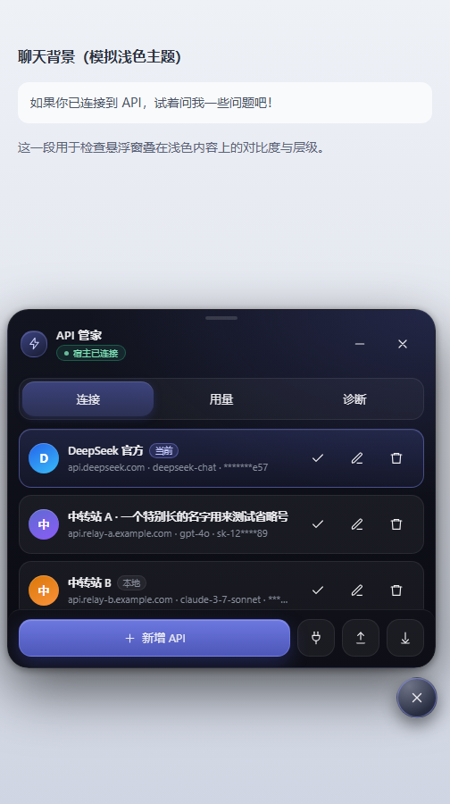

# API 悬浮管家

> TauriTavern / SillyTavern 的 API 连接管理悬浮窗
> 当前版本：**0.6.7** · 适用于 TauriTavern 2.3.0（SillyTavern 1.18 前端）

一个常驻在聊天界面右下角的悬浮窗，用来管理多套 API（官方 / 中转站）、一键切换酒馆当前使用的 API，并查看本机用量。

> **0.6.7 修复**：新 Key 写入后显式激活为当前项，避免切换后仍拿旧 Key 请求新地址；切换/保存不再自动点「连接」，避免失败时弹红色报错。



## 功能

- **多 API 档案**：名称、Base URL、提供商、模型、Key 分开保存，随时切换。
- **读取酒馆配置**：一键把当前酒馆的 API 配置存成档案。
- **已保存密钥下拉**：直接复用酒馆 `api_key_*` 槽位里的 Key，不必重复粘贴。
- **一键切换**：写回酒馆的 `chat_completion_source` / `custom_url` / 模型，并触发「连接」。
- **本机用量**：记录今日请求数、输入 Tokens、输出 Tokens，只保留最近 31 天。
- **自动故障切换**：401/429 时按列表顺序切到下一条宿主连接；默认不自动重发，避免重复消息。
- **导入 / 导出**：导出默认脱敏，只有你确认时才包含明文 Key。
- **安全兜底**：宿主设置中不保存明文 Key；陌生地址使用前会二次确认；拒绝非 http(s) 地址。

## 目录结构

```
api-floating-manager/
├─ README.md                     # 本文件
├─ 使用说明.md                    # 面向使用者的完整说明
├─ API悬浮管家.script.json        # 手机端「酒馆助手」直接导入的脚本
├─ pc/                           # 电脑端扩展源码
│  ├─ index.js
│  ├─ style.css
│  ├─ manifest.json
│  └─ install.ps1
├─ mobile/                       # 手机端源码与构建脚本
│  ├─ README.md                  # 移动端构建说明
│  ├─ mobile.js                  # 移动端运行时补丁（软键盘避让）
│  ├─ build-mobile.ps1           # 从 pc/ 生成 mobile/dist/tauri-api-manager-mobile
│  ├─ build-script-json.ps1      # 从 pc/ 生成根目录的 .script.json
│  └─ dist/
│     └─ tauri-api-manager-mobile/   # 可直接作为扩展安装的移动版目录
└─ screenshots/                  # README 用截图
```

## 快速开始

### 电脑版（TauriTavern 客户端）

```powershell
cd pc
pwsh -File .\install.ps1
```

脚本会复制到：

```
%APPDATA%\com.tauritavern.client\data\extensions\third-party\tauri-api-manager
```

然后重启 TauriTavern，或刷新页面。右下角出现悬浮球即可。

如需安装到其它数据目录：

```powershell
pwsh -File .\install.ps1 -DataDir "D:\somewhere\com.tauritavern.client\data"
```

### 手机版（推荐：酒馆助手脚本）

1. 把根目录的 `API悬浮管家.script.json` 传到手机；
2. 打开酒馆助手（JS-Slash-Runner）→ 脚本库 → 全局；
3. 导入该 JSON，打开脚本开关；
4. 刷新酒馆页面，右下角出现悬浮球。

> 如果酒馆助手开启了「使用 blob iframe」，扩展会因跨域无法注入，请关闭该选项。

### 手机版（扩展目录）

`mobile/dist/tauri-api-manager-mobile/` 是一个标准扩展目录（`manifest.json` 在根）。可以：

- 把它单独推到 GitHub，在 App 的「安装扩展」里填仓库 URL；
- 或按 `pc/install.ps1` 的方式复制到扩展目录验证。

## 从源码重新构建

需要 PowerShell 5.1+。

```powershell
cd mobile

# 1. 生成移动版扩展目录
pwsh -File .\build-mobile.ps1

# 2. 生成酒馆助手脚本 JSON（输出到仓库根目录）
pwsh -File .\build-script-json.ps1
```

构建逻辑：

- `mobile/build-mobile.ps1`：把 `pc/` 的 `index.js` + `mobile.js` 合并，复制 `style.css`，改写 manifest 显示名；
- `mobile/build-script-json.ps1`：把同样的代码和样式包装成酒馆助手 Script JSON。

## 上传到 GitHub

```powershell
cd api-floating-manager
git init
git add .
git commit -m "feat: API 悬浮管家 0.6.7"
git branch -M main
git remote add origin https://github.com/<你的账号>/<仓库名>.git
git push -u origin main
```

仓库根目录已经有 `README.md`、`使用说明.md` 和可直接导入的 JSON，GitHub 页面可以直接展示。

## 文档

完整安装、界面、切换、密钥、用量、故障排查见 [使用说明.md](使用说明.md)。

## 安全说明

1. 填了新 Key 时优先写宿主机密存储 `/api/secrets/write`；成功后本地缓存只保留 `secretRef`。
2. 宿主设置（会进 `settings.json`）只写脱敏副本，不保存明文 Key。
3. `localStorage` 仅在宿主机密路由不可用时作为兜底；旧版本遗留的明文 Key 会在下次保存/使用时清掉。
4. 导出文件只有你选「确定」时才包含明文 Key，请勿提交到仓库或发到群里。
5. 扩展本身不会向第三方域名发请求；请求只会发往你填写的 Base URL 或酒馆自身的 `/api/*`。

## 兼容性

- TauriTavern 2.3.0（SillyTavern 1.18 前端），Windows / Android。
- 普通 SillyTavern 网页版可使用「本地模式」，但读不到 Tauri 的 LLM 连接与 Agent Profile。
- 首次切换自定义端点时，宿主会弹「允许连接到自定义端点？」，点一次「信任并连接」即可。

## 已知限制

- 用量依赖服务商返回 `usage`；流式响应在结束时读取，不返回时只计请求数。
- 本地用量只保留 31 天，清空统计不影响宿主日志。
- 自动故障切换不会自动重发上一条消息，需要手动点发送。
- 手机端 UI 若被其它主题用 `* { border-radius: 0 !important }` 强制方角，0.6.5+ 已做圆角防御。
