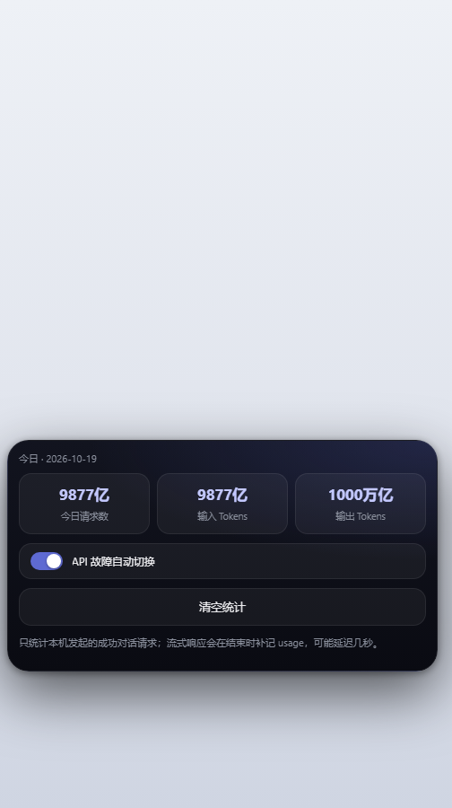

# API 悬浮管家 · 使用说明

> 适用版本：0.6.7 · TauriTavern 2.3.0（SillyTavern 1.18 前端）
> 支持 Windows 客户端、Android 客户端，以及普通 SillyTavern 网页版（本地模式）。

---

## 一、安装

### 1.1 电脑版

在仓库根目录执行：

```powershell
cd pc
pwsh -File .\install.ps1
```

默认目标：

```
%APPDATA%\com.tauritavern.client\data\extensions\third-party\tauri-api-manager
```

装完重启 TauriTavern 或刷新页面，右下角会出现圆形悬浮球。

若你的数据目录不在默认位置：

```powershell
pwsh -File .\install.ps1 -DataDir "D:\your-data\com.tauritavern.client\data"
```

### 1.2 手机版（推荐：酒馆助手 JSON）

1. 把根目录的 `API悬浮管家.script.json` 发送到手机；
2. 酒馆助手（JS-Slash-Runner）→ 脚本库 → 全局 → 导入；
3. 选中该 JSON，打开脚本开关；
4. 刷新酒馆页面，右下角出现悬浮球。

> 酒馆助手如果开启了「使用 blob iframe」，扩展无法注入父页面，请关闭该选项。

### 1.3 手机版（扩展目录）

把 `mobile/dist/tauri-api-manager-mobile/` 作为一个 Git 仓库推送，在 TauriTavern 的「安装扩展」里填仓库 URL；或在 PC 上按扩展目录方式复制进去。

---

## 二、界面


- **悬浮球**：默认在输入框右上方；可拖动，位置会记住。
- **打开 / 关闭**：点悬浮球打开；打开时它变成「×」，再点关闭。
- **面板**：连接 / 用量 / 诊断三个页签；手机端为贴底卡片，列表最多显示 3 条，其余滚动。
- **拖动**：按住标题栏拖动；位置限制在屏幕内，软键盘弹起时会自动避让。

---

## 三、添加 / 编辑 API

点击底部「新增 API」：

| 字段 | 说明 |
| --- | --- |
| 名称 | 自定义，用来区分档案 |
| Base URL | 填到 `/v1` 为止，不要带 `/chat/completions` |
| API Key | 可留空，表示复用酒馆已保存的密钥 |
| 已保存的密钥 | 从 `api_key_<source>` 槽位里选择，选中后 Key 输入框禁用 |
| 提供商 | openai / deepseek / claude / google / custom 等 |
| 模型 | 可手动填；「测试连接」成功后会从 `/models` 自动补全 |

「测试连接」会优先走宿主的状态接口（使用已保存的 Key），没有该接口时直连 `/models`。

> 编辑「本地 / 导入」条目并测试连接时，会先确认是否把 Key 发送到该域名。

---

## 四、切换 API

在连接列表点「✓」：

1. 把 Key 写入宿主机密槽位，并显式激活为当前生效项（失败会提示）；
2. 写入酒馆的 API 来源、Base URL、模型；
3. **不会自动点「连接」**，避免测试请求失败时弹红色报错；下一次对话直接使用新配置，需要自检时再手动点；
4. 成功后标记「当前」。

首次连接自定义端点时，TauriTavern 会弹「允许连接到自定义端点？」，点一次「信任并连接」，同端点后续不再询问。

如果提示「设置未生效」，去「诊断」页看当前 `chat_completion_source` / `custom_url`，或手动在酒馆 API 面板点一次连接。

---

## 五、密钥与安全

- 新 Key 优先写入 `/api/secrets/write`；成功后本地只留 `secretRef`。
- 宿主设置 `extension_settings.tauri-api-manager` 只写脱敏副本，不含明文 Key。
- 宿主机密路由不可用时，Key 会留在本机 `localStorage` 兜底。
- 导出默认脱敏；选「确定」才导出明文 Key，请勿提交到 GitHub 或发到群里。
- 使用「本地 / 导入」条目时，会确认目标域名；`javascript:`、`file:` 等地址直接拒绝。
- 普通酒馆没有 Tauri ABI 时显示「本地模式」，不要误以为插件不可用。

---

## 六、用量



「用量」页显示：

- 今日请求数
- 今日输入 Tokens
- 今日输出 Tokens

每次成功的对话请求自动累加；普通 JSON 直接读 `usage`，流式响应在结束时读尾部 `usage`。只保留最近 31 天。

- 数字过大时压缩为 `1.2万 / 1.2亿 / 1.2万亿`，悬停（或长按）可看完整值。
- 「清空统计」清掉本机所有日期的用量，不影响宿主日志。
- 「API 故障自动切换」开关控制 401/429 时是否自动换线。

如果服务商不返回 `usage`，只计请求数，Tokens 显示 0。

---

## 七、自动故障切换

触发条件：

- 对话请求返回 HTTP 401 / 429；
- 或宿主流式响应里出现 `[API Error]` 且带 401/429 文案。

行为：

- 按列表顺序切到下一条**宿主**连接（环形）；
- 15 秒内只触发一次；
- 少于 2 条不触发；
- **不会自动点发送**，避免重复消息，请手动重发；
- 本地 / 导入条目不参与，避免把对话发给未验证地址。

关闭方式：用量页的开关，或设置 `autoFailover = false`。

---

## 八、导入 / 导出

底部三个图标：

1. **读取酒馆配置**：把当前酒馆 API 存成档案；
2. **导出配置**：先询问是否包含明文 Key；
3. **导入配置**：支持裸数组或 `{ items: [...] }`。

限制：

- 单次最多 500 条；
- 文件不超过 2 MB；
- 非 `http(s)` 地址条目会被跳过；
- 脱敏文件导入不会覆盖本地已有 Key。

导入后如列表未刷新，切换一次页签或刷新页面。

---

## 九、诊断

「诊断」页显示：

- `window.__TAURITAVERN__` 的命名空间与方法；
- 酒馆控件是否存在；
- 当前 API 来源 / 地址 / 模型；
- 「探测 customApiFormat」会创建并删除临时连接，失败会提示清理失败。

排障时点「复制诊断信息」把 JSON 发出来即可。

---

## 十、常见问题

| 现象 | 处理 |
| --- | --- |
| 右下角没有悬浮球 | 确认扩展已安装 / 脚本已启用；重启 App 或刷新页面 |
| 切换后仍用旧 Key 请求（报 Unauthorized，尾号还是上一把） | 0.6.7 已修复：新 Key 写入后会显式激活；升级后重新切换一次 |
| 切换后弹巨大的红色报错 | 旧版会自动点「连接」触发测试请求；0.6.7 已取消，设置已写入，直接发消息即可 |
| 面板显示「本地模式」 | 普通酒馆没有 Tauri ABI，属于正常降级 |
| 保存报 `secret_key_mismatch` | 使用 0.6.1+，密钥槽会自动用 `api_key_<source>` |
| 404 `Failed to list models` | Base URL 带了 `/chat/completions`，改成 Base 后重新保存 |
| 401 / 429 | 检查 Key；开启自动切换时会自动换线，但需要手动重发 |
| 用量一直是 0 | 服务商没返回 `usage`，或请求没有走 `/chat/completions` |
| 手机上面板是方的 | 其它主题强制 `border-radius: 0 !important`；0.6.5+ 已防御，升级并刷新 |
| 更新后样式没变 | 0.6.5+ 会替换旧 `<style>`；仍不生效就彻底重启 App |
| 首次切换弹信任框 | 点「信任并连接」，同端点只问一次 |

---

## 十一、从源码构建

```powershell
cd mobile
pwsh -File .\build-mobile.ps1
pwsh -File .\build-script-json.ps1
```

- `build-mobile.ps1` 生成 `mobile/dist/tauri-api-manager-mobile/`；
- `build-script-json.ps1` 生成根目录 `API悬浮管家.script.json`。

改动代码时只需要改 `pc/index.js`、`pc/style.css`、`mobile/mobile.js`，然后重新跑上面两条命令。

---

## 十二、安全边界

- 扩展不向第三方域名发请求；请求只发往你填的 Base URL 或酒馆自身的 `/api/*`。
- 同源的其它酒馆脚本理论上能读 `localStorage`，只安装可信脚本。
- 使用 `http://` 会明文传输 Key，能上 `https://` 就别用 `http://`。
- 宿主机密文件（`secrets.json`）由 TauriTavern 管理；本扩展不负责磁盘加密。

